<div align="center">



<br>

<a href="https://github.com/thiagodanjos/lissecurity/releases/latest"></a>
<a href="https://github.com/thiagodanjos/lissecurity/releases"></a>
<a href="https://github.com/thiagodanjos/lissecurity/actions/workflows/ci.yml"></a>

<a href="LICENSE"></a>

</div>

<br>

O **LisSecurity** guarda as tuas senhas, contas bancárias, cartões e notas confidenciais num
ficheiro cifrado **no teu computador**. Não há conta para criar, não há servidor e não precisa de
internet: o cofre só abre com a tua senha mestra (ou com a chave de recuperação, se a criares).
Não existe senha universal nem "suporte" capaz de o abrir por ti.

<br>

## Ecrãs



<sub>Capturas da app real, feitas pelo teste automático com dados fictícios. Todas em [`docs/capturas`](docs/capturas).</sub>

## O que faz



## Instalar

| | |
| :-- | :-- |
| **1 · Descarregar** | Em **[Releases](https://github.com/thiagodanjos/lissecurity/releases/latest)**, descarrega `LisSecurity_…_x64-setup.exe` (em *Assets*). |
| **2 · Instalar** | Abre o ficheiro. Instala só para o teu utilizador, sem pedir administrador. O instalador ainda não tem assinatura de código, por isso o SmartScreen avisa: escolhe **Mais informações → Executar mesmo assim**. |
| **3 · Criar o cofre** | Escolhe uma senha mestra longa (uma frase de quatro ou mais palavras funciona bem) e guarda a **chave de recuperação** fora do computador. |

Funciona no **Windows 10 e 11 (64 bits)**. O WebView2 já vem com o Windows; se faltar, o instalador trata disso.

> [!TIP]
> Cada Release mostra o **SHA-256** do instalador. Para confirmar que o ficheiro é exatamente o que
> foi compilado pelo GitHub Actions, no PowerShell: `Get-FileHash .\LisSecurity_*_x64-setup.exe`

## Como os teus dados ficam protegidos



- **Argon2id** (RFC 9106) transforma a senha mestra numa chave. É calibrado no teu PC (por omissão, cerca de 0,75 s e 128 MiB por tentativa), o que torna muito caro adivinhar senhas à força; nas definições podes reforçá-lo.
- **XChaCha20-Poly1305** cifra e autentica o cofre inteiro: se um único byte do ficheiro for alterado, o cofre recusa abrir.
- A **chave do cofre** é aleatória e a senha mestra só a protege. Trocar a senha mestra gera chaves novas.
- O núcleo em **Rust** não usa código `unsafe` e apaga os segredos da memória ao bloquear. A interface recebe os dados mascarados e só vê o valor real quando pedes para o mostrar ou copiar.
- **Bloqueia sozinho** por inatividade, ao minimizar, ao suspender o PC e com Win+L. O que copias sai da área de transferência ao fim de 30 segundos (ajustável), mas só se ainda lá estiver.
- Cada gravação é **atómica e verificada**: se o PC desligar a meio, o cofre anterior continua intacto.

O modelo de ameaças, o formato do ficheiro e as decisões técnicas estão em **[docs/SEGURANCA.md](docs/SEGURANCA.md)**.

> [!IMPORTANT]
> O LisSecurity está na versão 0.x e ainda **não teve uma auditoria de segurança independente**.
> Nenhuma app protege um computador que já está comprometido (por exemplo, com um programa que
> regista o teclado). Usa uma senha mestra longa e faz cópias de segurança.

## Cópias de segurança

- **Google Drive (recomendado):** instala o [Google Drive para computador](https://www.google.com/drive/download/) e, no LisSecurity, abre *Cópias de segurança → Google Drive → Ligar*. A cada alteração fica uma cópia cifrada em `O meu disco/LisSecurity/`, e o Drive envia-a para a nuvem. A Google só vê um ficheiro cifrado.
- **Manuais:** para uma pen ou outro disco. Cada cópia é relida e verificada depois de gravada.
- **Testar e restaurar:** *Testar uma cópia* abre-a sem mexer no cofre atual. Num PC novo, *Restaurar uma cópia de segurança* mostra as cópias que encontrar no Drive.

Uma cópia abre com a senha mestra que estava em uso quando foi feita. Depois de trocares a senha, faz uma cópia nova.

## Perguntas frequentes

<details>
<summary><b>Esqueci-me da senha mestra. E agora?</b></summary>
<br>

Só a **chave de recuperação** abre o cofre sem a senha mestra, e só se a tiveres criado. Não há
recuperação por e-mail, nem pergunta secreta, nem ninguém que o consiga abrir por ti: é isso que
garante que mais ninguém o abre.

</details>

<details>
<summary><b>Os meus dados vão para algum servidor?</b></summary>
<br>

Não. A app não faz pedidos à internet (a política de segurança da janela nem o permite) e não tem
telemetria. As cópias no Google Drive são gravadas numa pasta do teu PC; quem as envia é o
programa do Google Drive, e o que segue é o ficheiro já cifrado.

</details>

<details>
<summary><b>Dá para ligar ao meu banco e ver os gastos em tempo real?</b></summary>
<br>

Não. Bancos como o Revolut não dão acesso às contas pessoais a apps de terceiros (só a
agregadores licenciados), e isso obrigaria a app a ir à internet e a guardar credenciais do banco.
Em vez disso, importas o **extrato em CSV** e o LisSecurity mostra os gastos por mês, dia e
categoria, a evolução de seis meses e os pagamentos recorrentes, tudo cifrado no cofre.

</details>

<details>
<summary><b>Posso usar o cofre noutro computador?</b></summary>
<br>

Sim: instala o LisSecurity no outro PC e restaura uma cópia de segurança (do Google Drive, de uma
pen…). Para usar nos dois ao mesmo tempo, o mais seguro é ter um cofre principal e ir restaurando
cópias, porque não há sincronização automática entre cofres.

</details>

<details>
<summary><b>Porque é que o Windows avisa ao instalar?</b></summary>
<br>

O instalador ainda não tem assinatura de código (um certificado pago). O SmartScreen avisa sobre
qualquer programa sem assinatura e com poucos downloads. Podes confirmar o ficheiro com o SHA-256
publicado em cada Release; o instalador é compilado pelo GitHub Actions a partir deste código.

</details>

<details>
<summary><b>Onde ficam os ficheiros?</b></summary>
<br>

| O quê | Onde |
| :-- | :-- |
| Cofre cifrado | `%APPDATA%\pt.lisfilms.lissecurity\cofre.lissec` |
| Versão anterior (cifrada) | `…\cofre.lissec.anterior` |
| Cópias antes de restaurar ou migrar (cifradas) | `…\cofre.lissec.antes-do-restauro-…` |
| Preferências de aparência (sem dados do cofre) | `…\preferencias.json` |

Desinstalar não apaga o cofre. Para o apagar, remove a pasta à mão.

</details>

## Para quem programa

| Pasta | O quê |
| :-- | :-- |
| [`core/`](core) | `lissecurity-core` em Rust (`#![forbid(unsafe_code)]`): Argon2id, XChaCha20-Poly1305, formato `.lissec`, gravação atómica, modelo de dados, vistas mascaradas, gerador, 2FA, importação e finanças. Tudo o que decide a segurança está aqui e é testado sozinho. |
| [`src-tauri/`](src-tauri) | Camada nativa (Tauri 2): sessão bloqueável, comandos específicos, integração com o Windows (suspensão, Win+L, área de transferência), janela sem moldura, CSP estrita e navegação bloqueada. |
| [`src/`](src) | Interface em React 19 + TypeScript + Vite + Tailwind 4 + framer-motion, com a identidade visual do LisFilms. |
| [`e2e/`](e2e) | Teste ponta-a-ponta que conduz a app real com WebDriver. |
| [`docs/`](docs) | [Segurança](docs/SEGURANCA.md) · [Design](docs/DESIGN.md) · [Testes](docs/TESTES.md) · [capturas](docs/capturas). |

**Compilar no Windows:** instala o [Rust](https://rustup.rs) (`stable-x86_64-pc-windows-msvc`),
o [Node.js 22](https://nodejs.org) e as *Ferramentas de Compilação do Visual Studio*
("Desenvolvimento para desktop com C++"). Depois, nesta pasta:

```bash
npm install
```

```bash
npm run dist
```

O instalador fica em `target/release/bundle/nsis/`. Para desenvolver com recarga automática: `npm run app`.

**Testes:** `cargo test --workspace` (núcleo e camada nativa), `npm test` (validações da interface)
e o teste ponta-a-ponta na app real (ver [docs/TESTES.md](docs/TESTES.md)). O
[workflow](.github/workflows/ci.yml) corre tudo isto em cada alteração, compila o instalador no
Windows e publica as Releases.

## Licença

O LisSecurity é software livre, com a [licença MIT](LICENSE): podes usar, estudar, modificar e
distribuir o código, desde que mantenhas o aviso de copyright. É fornecido "tal como está", sem
garantias.

Componentes de terceiros incluídos: a lista de palavras BIP-39 em português do gerador
(`core/recursos/palavras-pt.txt`, MIT), a fonte Inter (SIL Open Font License), os ícones Lucide
(ISC) e as bibliotecas Rust do projeto RustCrypto (MIT/Apache-2.0).

<br>

<div align="center">
<sub>Feito por <a href="https://github.com/thiagodanjos">Thiago Anjos</a> · da família Lis: <a href="https://lisfilms.pt">LisFilms</a>, LisGames e <a href="https://github.com/thiagodanjos/lisdiscord">LisDiscord</a></sub>
</div>
